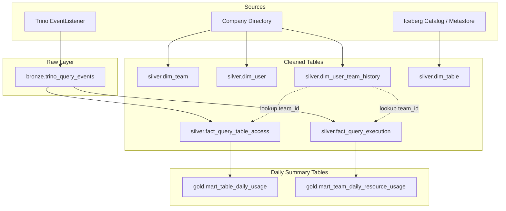

<h1 align="center">
  Meta DWH<br>
  <samp><sub>Data Engineering&nbsp;·&nbsp;JetBrains&nbsp;·&nbsp;Nikita Paniukhin</sub></samp>
</h1>


A data warehouse model and transformation pipeline to track Trino query workloads, Iceberg table usage, and team resource consumption in Amazon S3.

## Data Model

The pipeline organizes Trino query completion events into three layers:



<!-- <details>
<summary>Diagram legend</summary>

* **Solid arrow (`──→`)**: Data flow (ETL ingestion, transformations, aggregations).
* **Dashed arrow (`╌╌⇢`)**: Team lookup based on query start time (`created_at`).

</details> -->

<table>
  <thead>
    <tr>
      <th align="center">Table</th>
      <th align="center">Granularity</th>
      <th align="center">Description</th>
    </tr>
  </thead>
  <tbody>
    <tr>
      <th colspan="3" align="center">Bronze (Raw)</th>
    </tr>
    <tr>
      <td><code>bronze.trino_query_events</code></td>
      <td>1 row per completed query (<code>query_id</code>)</td>
      <td>Raw query completion events from Trino <code>QueryCompletedEvent</code> partitioned by <code>event_date</code></td>
    </tr>
    <tr>
      <th colspan="3" align="center">Silver (Cleaned & Dimensions)</th>
    </tr>
    <tr>
      <td><code>silver.dim_team</code></td>
      <td>1 row per team (<code>team_id</code>)</td>
      <td>Teams and departments directory</td>
    </tr>
    <tr>
      <td><code>silver.dim_user</code></td>
      <td>1 row per user (<code>user_name</code>)</td>
      <td>Users and service accounts</td>
    </tr>
    <tr>
      <td><code>silver.dim_user_team_history</code></td>
      <td>1 row per user assignment (<code>user_name</code>, <code>valid_from</code>)</td>
      <td>Historical user-to-team assignments with date ranges</td>
    </tr>
    <tr>
      <td><code>silver.dim_table</code></td>
      <td>1 row per table (<code>table_name</code>)</td>
      <td>Tables catalog and ownership metadata</td>
    </tr>
    <tr>
      <td><code>silver.fact_query_execution</code></td>
      <td>1 row per query execution (<code>query_id</code>)</td>
      <td>Query runtime metrics (CPU, RAM, data scanned, cost) and team attribution</td>
    </tr>
    <tr>
      <td><code>silver.fact_query_table_access</code></td>
      <td>1 row per table accessed (<code>query_id</code>, <code>table_name</code>)</td>
      <td>Individual table read metrics without duplicating query-level compute metrics</td>
    </tr>
    <tr>
      <th colspan="3" align="center">Gold (Daily Summary)</th>
    </tr>
    <tr>
      <td><code>gold.mart_table_daily_usage</code></td>
      <td>1 row per day per table (<code>execution_date</code>, <code>table_name</code>)</td>
      <td>Daily table-level activity, user counts, and scanned volume</td>
    </tr>
    <tr>
      <td><code>gold.mart_team_daily_resource_usage</code></td>
      <td>1 row per day per team (<code>execution_date</code>, <code>team_id</code>)</td>
      <td>Daily team-level resource consumption, query counts, and costs</td>
    </tr>
  </tbody>
</table>

[View SQL definitions here](ddl/)

---

# Queries

#### Question 1: Distinct users querying table X during a period

* **Exact answer**: Queries `silver.fact_query_table_access` with `COUNT(DISTINCT user_name)` (distinct users across multiple days cannot be summed).
* **Daily trend**: Queries `gold.mart_table_daily_usage`.

[View SQL query here](queries/q1_distinct_users_per_table.sql)

---

#### Question 2: Resources consumed by team Y during a period

* **Total for period**: Aggregates `gold.mart_team_daily_resource_usage` (`SUM` of queries, CPU hours, data scanned, cost, and `MAX` of peak memory).
* **Daily trend**: Queries `gold.mart_team_daily_resource_usage` grouped by `execution_date`.

[View SQL query here](queries/q2_team_resource_consumption.sql)

---

#### Extra Queries

The data model also supports other queries, for example:
1. Tables with no queries in the last N days (potentially unused).
2. Top queries by CPU consumption in the last N days.
3. Top tables by scanned volume in the last N days.

[View SQL queries here](queries/extra_queries.sql)

---

### Design Details

* **Resource metrics & cost**:
  Query resource usage is measured by CPU time (`cpu_time_hours`) and peak memory (`peak_memory_bytes`). S3 data scanned (`physical_input_bytes`) tracks compressed bytes read from storage.
  Costs are calculated as: `cost = (cpu_hours * $0.04) + (scanned_tb * $5.00)`.

* **Multi-table queries**:
  CPU, RAM, and cost are tracked once in `fact_query_execution`. Per-table byte and row counts are stored separately in `fact_query_table_access`.

* **Team attribution over time**:
  In case users change teams, `dim_user_team_history` tracks date ranges (`valid_from` to `valid_to`). Queries are attributed to teams based on query start time (`created_at`), which also works if a query runs past midnight.

* **Idempotent partition writes**:
  Tables are partitioned by `execution_date`. Pipelines overwrite target partitions on each run (`INSERT OVERWRITE` in Trino, `.writeTo().overwrite()` in PySpark), making backfills and re-runs safe to run.

* **Table registry**:
  `dim_table` stores the list of known tables and their owning teams (`owner_team_id`), synced daily from the Iceberg catalog.

---

### Demo

A simple SQLite demo runs [automatically](https://github.com/npanuhin/edu-JetBrains-meta-dwh/actions/workflows/ci.yml). To run manually:

```sh
python demo/run_demo.py
```
